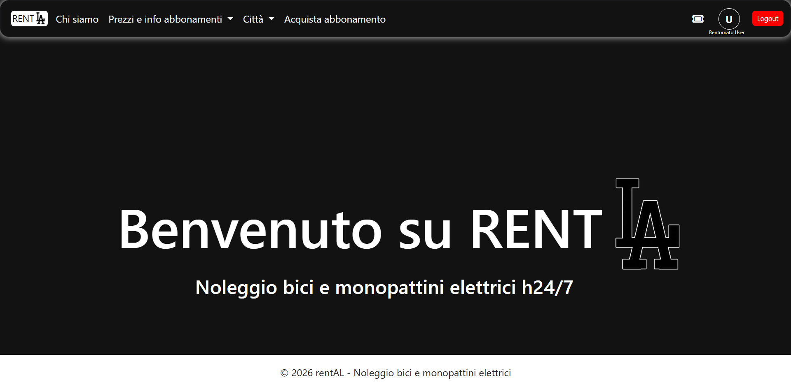
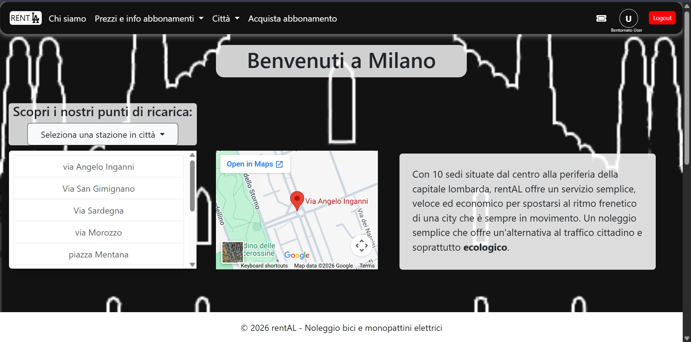
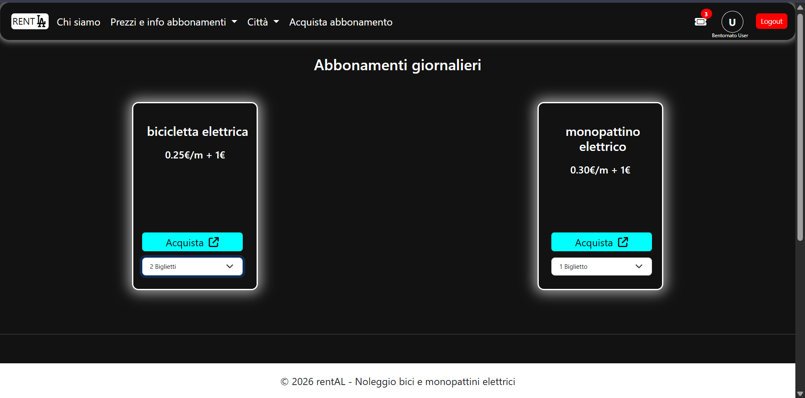
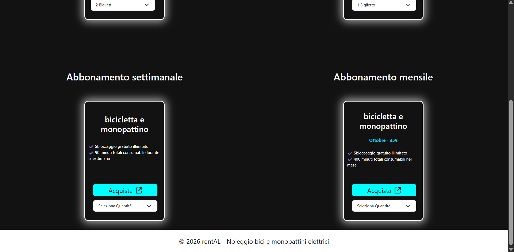
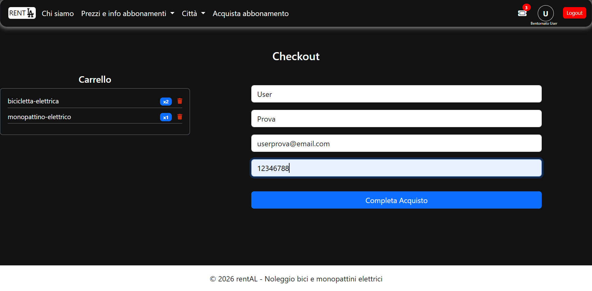
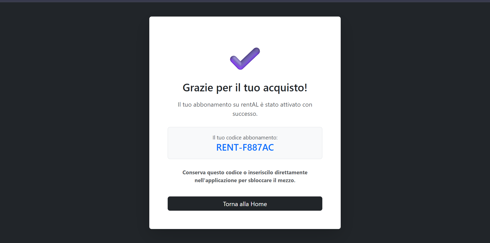

# rentAL

Demo di un servizio di noleggio a breve e lungo termine di biciclette e monopattini elettrici.

> ⚠️
> Progetto personale a scopo dimostrativo. Pagamenti e dati sono fittizi.
> Loghi e marchi citati appartengono ai rispettivi proprietari.
> Sto attualmente lavorando allo sviluppo dell'Applicazione Mobile, il codice noleggio è dimostrativo.
> Il numero della carta di credito può essere un qualsiasi numero, es.('1' o '43675').

## Screenshots progetto

## Tecnologie usate
- Laravel (PHP)
- Blade (template engine di Laravel)
- Bootstrap 5
- CSS personalizzato e media query per il responsive
- JavaScript
- SQLite
